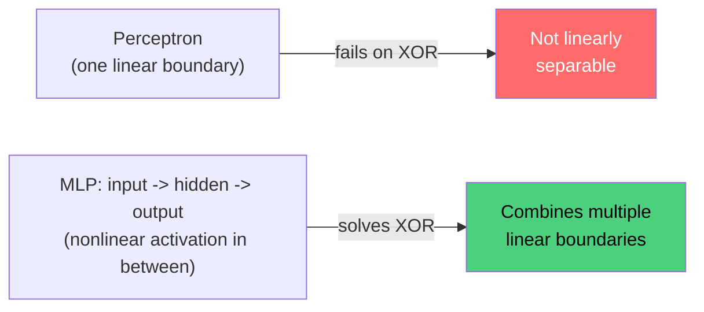

# Section 9.1 — Neural Network Basics

> Phases 5-8 used models where `sklearn`/`statsmodels` handled the internals. This section
> opens the box: a perceptron and a full MLP with backpropagation, built from scratch in raw
> NumPy — no autograd — so every later PyTorch call is demystified rather than magic.

## Why this matters for ML specifically

- The perceptron's failure on XOR (provably, not just by bad luck) is the exact historical
  reason hidden layers exist — this section reproduces that failure directly.
- The notebook ends by checking the hand-derived backprop gradients against PyTorch's
  autograd — proof the two are the same calculus, not a leap of faith.

## Real data, loaded directly from GitHub

**Banknote Authentication** — 1,372 real measurements from wavelet-transformed images of
genuine and forged banknotes. Loaded with `pd.read_csv(url)` from
[`jbrownlee/Datasets`](https://raw.githubusercontent.com/jbrownlee/Datasets/master/banknote_authentication.csv).
Small and nearly linearly separable — exactly what makes the perceptron's successes AND
failures legible.

## Notebook

| # | Notebook | Topics covered |
|---|----------|-----------------|
| 1 | [`01_perceptron_mlp_backprop.ipynb`](notebooks/01_perceptron_mlp_backprop.ipynb) | Perceptron learning rule, XOR failure, activation functions (sigmoid/tanh/ReLU) and their derivatives, MSE vs. BCE loss, a hand-coded MLP with manual backpropagation, verified against PyTorch autograd |

## Why a hidden layer is necessary



## Topic checklist

- [ ] Perceptron
- [ ] MLP
- [ ] Activation Functions
- [ ] Loss Functions
- [ ] Backpropagation

## How to run

```bash
pip install numpy pandas scikit-learn matplotlib torch
jupyter lab
```

## Self-assessment

1. Why does the perceptron learning rule provably never converge on XOR, no matter how long
   you train it?
2. What breaks a neural network's expressive power if every layer is linear with no
   activation function at all?
3. Why is binary cross-entropy the standard loss for classification instead of MSE, in terms
   of the gradient it produces for a confidently wrong prediction?
4. Walk through, in your own words, what `dz2 = a2 - y` in the hand-coded backward pass
   represents, and why cross-entropy makes that gradient so simple.
5. What did comparing the manual gradient to PyTorch's autograd gradient actually prove?
