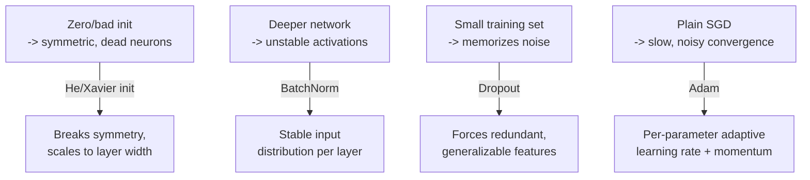

# Section 9.2 — Training Dynamics

> Section 9.1 proved backpropagation works. This section covers everything that determines
> whether it works WELL — the difference between a network that trains smoothly and one
> that stalls, explodes, or memorizes noise.

## Why this matters for ML specifically

- All-zero weight initialization is a real, common beginner mistake — this section shows
  concretely why it breaks learning (the "symmetry problem"), not just states it.
- The dropout ablation reproduces Phase 4's bias-variance tradeoff INSIDE a single network,
  making overfitting visible as a train/validation accuracy gap rather than an abstract idea.

## Real data, loaded directly from GitHub

**MNIST** (10,000-image subset) — real handwritten digit images, loaded directly from
[`fgnt/mnist`](https://raw.githubusercontent.com/fgnt/mnist/master/train-images-idx3-ubyte.gz)
as the original 1998 IDX binary format, decoded by hand rather than via a bundled loader.

## Notebook

| # | Notebook | Topics covered |
|---|----------|-----------------|
| 1 | [`01_init_normalization_dropout_optimizers.ipynb`](notebooks/01_init_normalization_dropout_optimizers.ipynb) | Weight initialization (zero/Xavier/He), SGD vs. momentum vs. Adam, BatchNorm on a deeper network, Dropout's effect on the train/validation gap |

## What each technique actually fixes



## Topic checklist

- [ ] Weight Initialization
- [ ] Normalization
- [ ] Dropout
- [ ] BatchNorm
- [ ] Optimization

## How to run

```bash
pip install numpy matplotlib torch
jupyter lab
```

## Self-assessment

1. Why does all-zero initialization make every neuron in a layer learn the exact same
   thing forever?
2. What does He initialization scale by, and why does that scaling matter more for ReLU
   than for sigmoid?
3. What does momentum add to plain SGD, and what does Adam add on top of momentum?
4. Explain, mechanically, what BatchNorm does to a layer's activations on every forward
   pass, and why that stabilizes training on a deeper network.
5. Why is the train/validation accuracy GAP the right thing to look at when evaluating
   dropout, rather than either accuracy alone?
